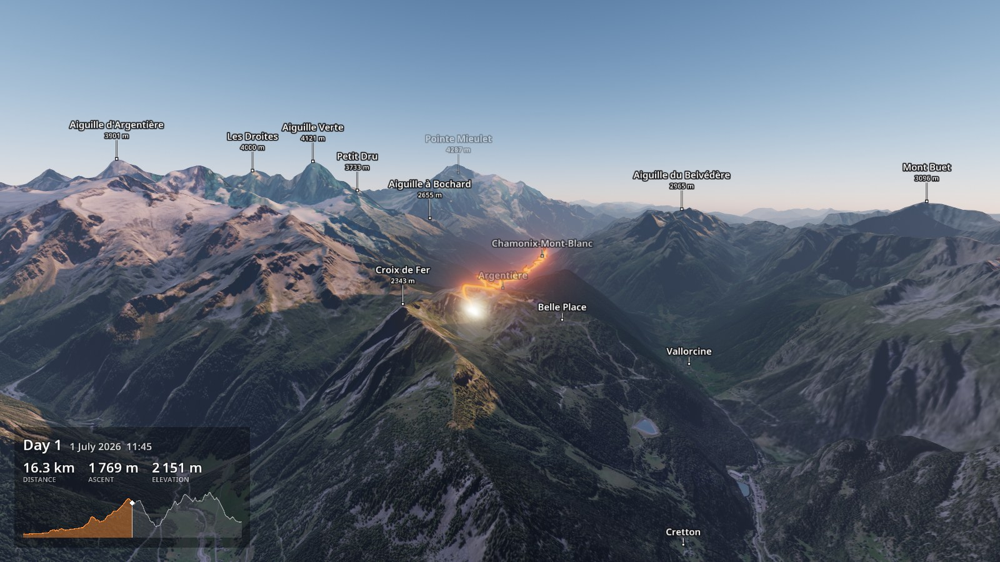
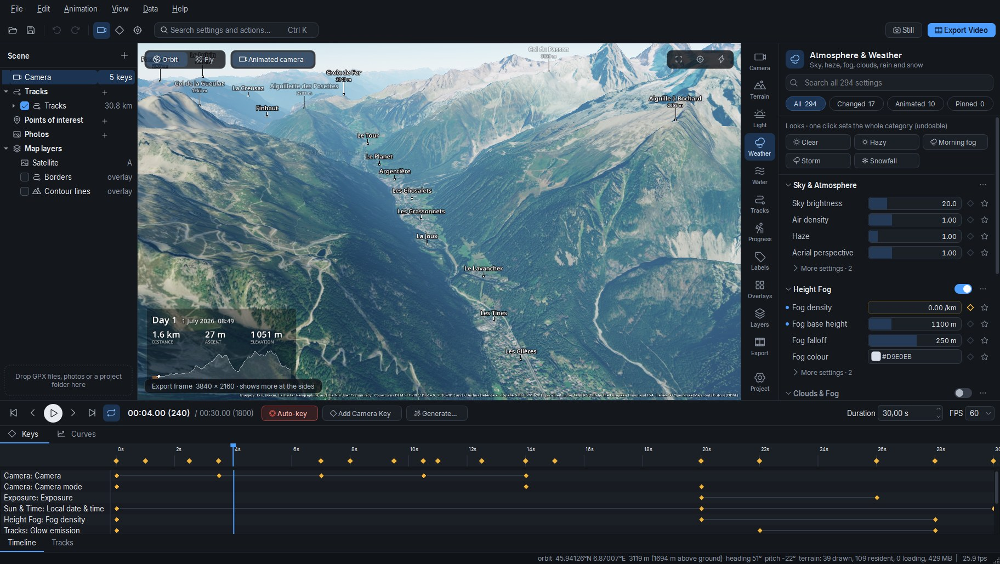
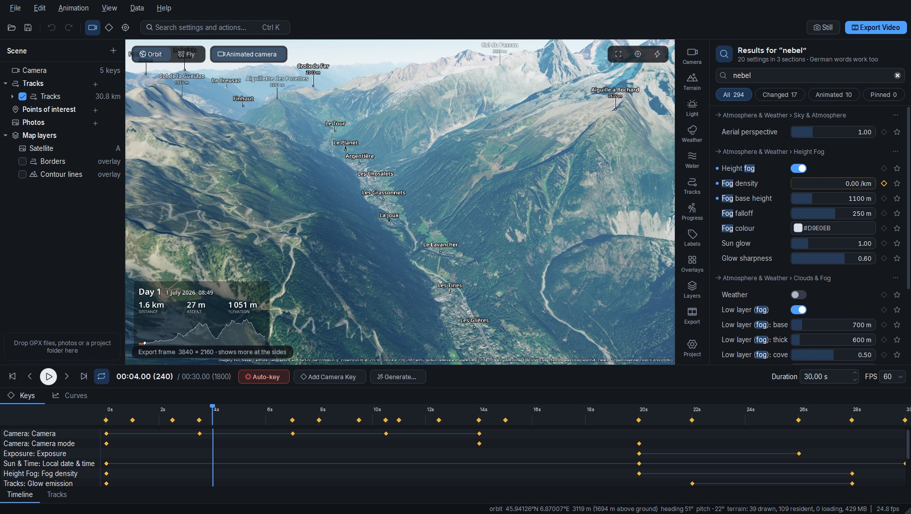
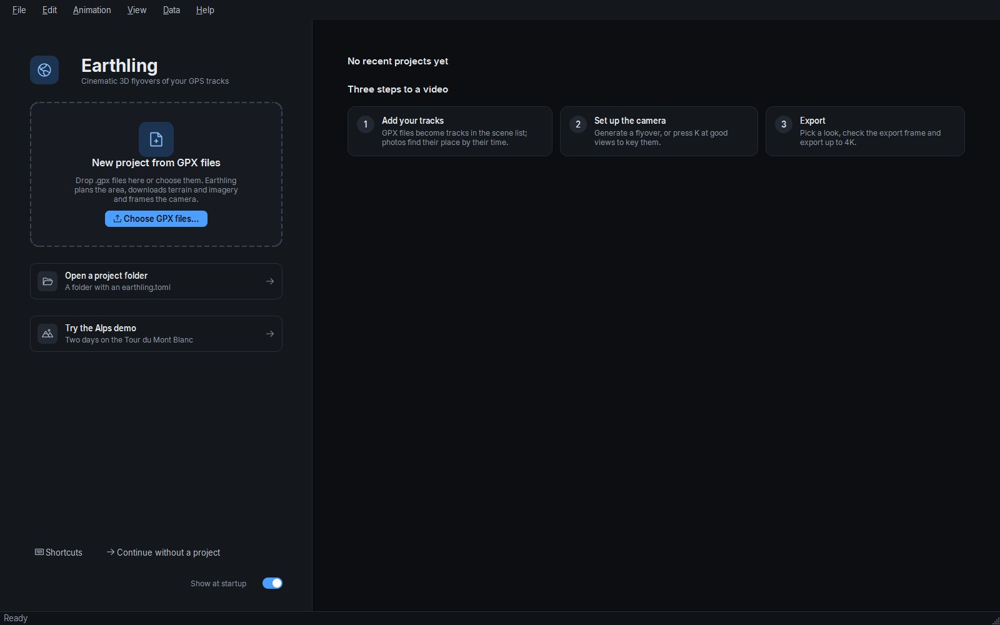
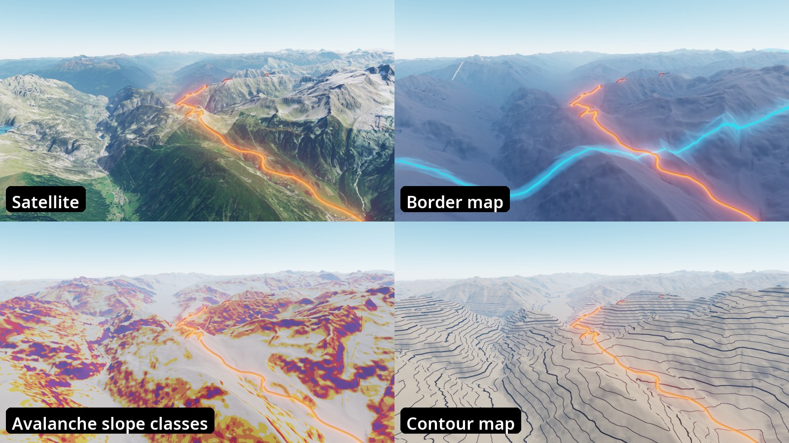
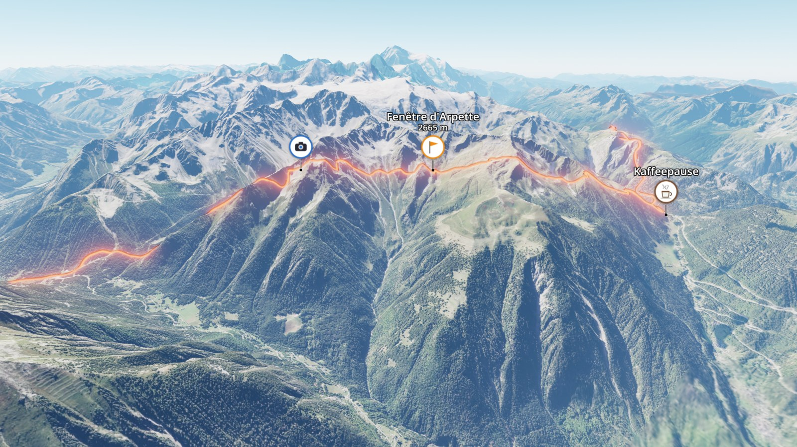
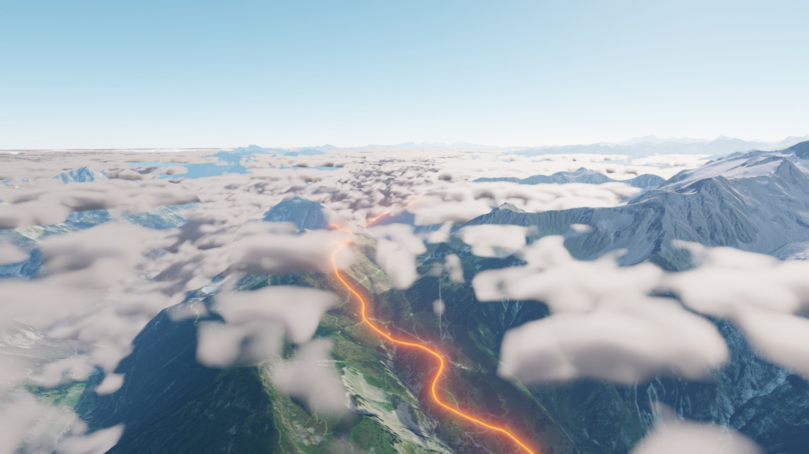
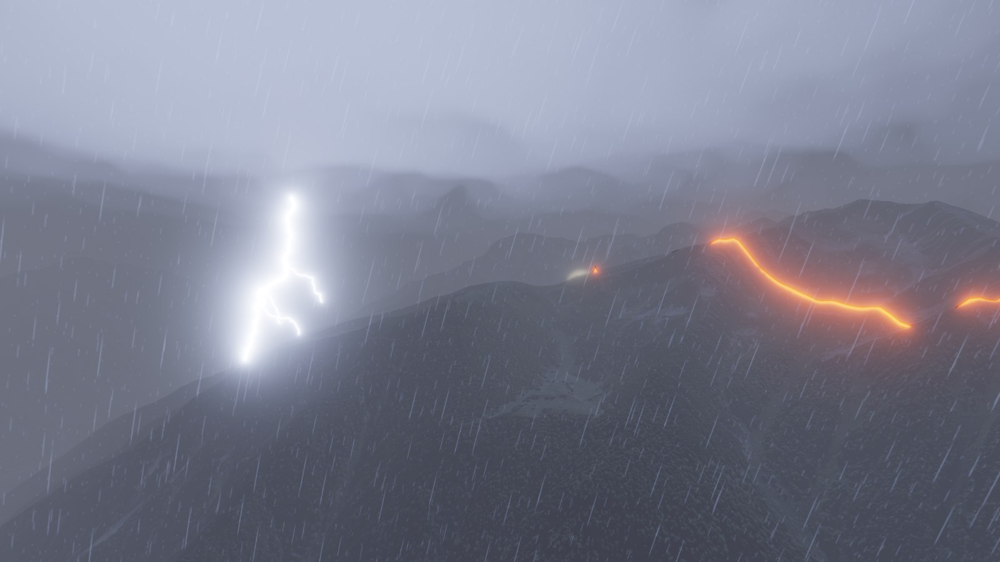
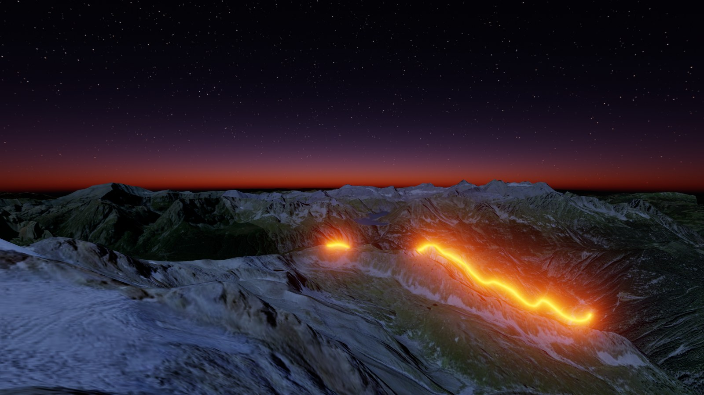
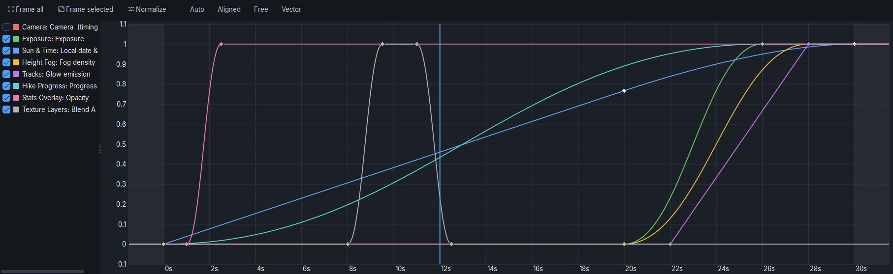

# Earthling

Cinematic 3D flyover videos of your hikes. Load GPX files, download satellite imagery and
elevation data, render the terrain with OpenGL shaders, animate everything on a keyframe
timeline and export 4K video.



## What it does

- **Real terrain, anywhere:** worldwide imagery and elevation (Esri World Imagery, Copernicus
  DEM), plus high-resolution national data built in for France (IGN) and Switzerland
  (swisstopo). You can add more regions in the project configuration.
- **Only what you need:** the downloads follow your tracks, with detail zones (for example
  the finest imagery within 1 km of the route, and coarse data 25 km out).
- **Physically based sky:** atmosphere with aerial perspective, sun position from date, time and
  place (or from the GPX timestamps), shadows, a night sky with stars.
- **Tracks that tell the story:** a progress head that follows the hike through time or
  distance, glow, casing, dashes for planned routes, and track groups with their own styles
  (for example "walked" and "official route"). Vehicles at the head (a ship, a plane, a
  cyclist ...), lines coloured by gradient, speed or heart rate, and several heads at once
  (a race against last year's run).
- **Overlays:** peak, pass and place labels (OpenStreetMap; optionally appearing as the
  line passes them), country names and large cities
  (Natural Earth) for journeys across a continent, a stats panel with distance, ascent, speed
  or pace, gradient, heart rate, the gap in a race, elevation profile and time of day (in
  English or German), a mini-map of the whole journey with the head on it, photos faded in on
  the screen (with a white frame, a shadow and a slow zoom), and data attribution.
- **Points of interest:** a library of 40+ generic kinds (peak, viewpoint, pass, hut, tent,
  water, town, toilet, parking, train ...), text badges ("10 km"), your own images (PNG,
  animated GIF or APNG, sprite sheets), captions, pop-in animations and effects. Place them at
  the hiker, with a click, at coordinates or at a point of a track (start, end, highest point,
  a distance); let them pop in when the drawn line reaches them.
- **Photos:** pictures on the screen, placed where they were taken (EXIF GPS or their time on
  the tracks), shown when the line gets there.
- **Weather:** volumetric fog and cloud layers (fields of cloud with clear gaps, bases and tops
  at varying heights) with shadows and gusting wind, rain with wet
  ground and reduced visibility, rainbows, snowfall and fresh snow above a snow line, and
  thunderstorms with lightning.
- **Water:** sea and lakes from the OpenStreetMap water areas reflect the sky and glint in the
  sun, with waves from the near swell to ripples in the distance; open water can take one even
  colour (no imagery tile seams at sea); tracks can switch style on water (a canoe trip:
  paddling and portages).
- **The whole globe:** views from space with the day and night side, the city lights at night
  (NASA Black Marble), and the local time of the place a journey passes.
- **Texture layers:** satellite, topographic map, a border map with glowing country borders,
  slope classes, aspect, elevation, contour lines and hillshade. Crossfade between any two.
- **Keyframe everything:** camera paths, sun, weather, layers and overlays on a timeline with
  a dope sheet and graph editor, undo/redo and auto-key. Scenes are saved as JSON.
- **An application that is easy to find your way in:** a scene list, an inspector with one
  category at a time, search in English or German, a command palette, looks for the light
  and the weather, and a start screen (see [The application](#the-application)).
- **Generated animation:** chase, map-view, orbit and along-the-line cameras, the line drawn
  from one track to another in its recorded time or at an even speed, the light from the
  tracks' clock, still seconds at both ends - all as editable keys (Animation menu).
- **Video export:** H.264, H.265, ProRes 4444 and DNxHR, up to 4K, landscape, portrait (9:16)
  or square, with anti-aliasing and motion blur. From the GUI or the command line.

## The application



- **Scene list** (left): the camera, the track groups and their tracks, points of interest,
  photos and map layers. The checkboxes show and hide, "+" adds (GPX files, lines, POIs at
  the marker or with a click, photos), and you can drop GPX files, pictures or a project
  folder on it. Selecting an entry shows its settings in the inspector.
- **Inspector** (right): a rail of categories (Camera, Terrain, Light, Weather, Water,
  Tracks, Progress, Labels, Overlays, Layers, Export) shows one category at a time. Sections
  have an on/off switch where that makes sense, rarely needed settings wait behind "More
  settings", and settings that do nothing right now are hidden (the follow distance appears
  in follow mode, the colour ramp when the line is coloured by a value). A number shows its
  value in a bar: drag it sideways (Shift: fine, Ctrl: coarse) or click to type.
- **Changed, animated, pinned:** a dot marks values that differ from their default
  (right-click: reset), amber values are animated, and the filters list the changed, the
  animated or the pinned (☆) settings of the whole scene.
- **Looks:** one click sets the light (Noon, Golden hour, Blue hour, Night, with the sun
  times of the scene's day and place) or the weather (Clear, Hazy, Morning fog, Storm,
  Snowfall).
- **Timeline:** play, frame steps, loop, Auto-key (red while it records), camera keys and
  the generators; "Keys" is the dope sheet, "Curves" the graph editor.
- **Export frame:** on a wide or ultra-wide screen the view darkens what a video does not
  show, and the stats, the mini-map and the photos sit in the frame as in the video.

| | |
|---|---|
|  |  |
| **Search** (Ctrl+F) finds every setting, in English or German. **Ctrl+K** opens the command palette: settings, actions, looks and help in one list | **Start screen:** a new project from GPX files, recent projects with a picture of their last view, the demo |

Every setting and action is also in the command palette; F1 lists the keyboard shortcuts.

## Gallery

| | |
|---|---|
|  |  |
| **Texture layers:** satellite, border map, avalanche slope classes, contour map | **Points of interest:** animated icons with captions and effects |
|  |  |
| **Weather:** fog banks and cloud layers with shadows | **Thunderstorms:** rain, branching lightning and flashes lighting up the scene |
|  |  |
| **Dusk and night:** afterglow, stars and a glowing track | **Graph editor:** eased keyframe curves for every animated property |

The pictures come from the demo project in [examples/alps_demo](examples/alps_demo), two
synthetic days on the Tour du Mont Blanc. [examples/showcase](examples/showcase) has ten more
scenes, from a dive from space into Patagonia to a canoe trip and a train across Siberia. [tools/make_readme_images.py](tools/make_readme_images.py)
renders them again.

## Quick start

```powershell
python -m pip install --user uv   # if uv is not installed
uv sync
uv run earthling fetch examples/alps_demo   # download imagery, elevation and labels
uv run earthling gui examples/alps_demo     # open the demo in the application
```

Earthling needs Python 3.12 and a GPU with OpenGL 4.3.

## Your own project

A project is a folder with your GPX files and an `earthling.toml`:

```toml
[project]
gpx_dir   = "gpx/"
cache_dir = "~/earthling-cache"   # shared between projects
timezone  = "Europe/Paris"

[area]
border_km = 8.0
zones = [   # finer data close to the tracks
  { within_km = 1.5, imagery_zoom = 16, dem_zoom = 13 },
  { within_km = 4.0, imagery_zoom = 15, dem_zoom = 12 },
  { within_km = 8.0, imagery_zoom = 13, dem_zoom = 11 },
]

[sources]   # in priority order; regional sources only where they have data
imagery = ["ign_bdortho", "swisstopo_swissimage", "esri_world_imagery"]
dem     = ["ign_rgealti", "swisstopo_alti3d", "copernicus_glo30"]
```

Several track groups can have their own detail zones and styles. For example, your walked days
can get full detail while a 3000 km planned route gets a coarse overview (`[[tracks]]`, see
[docs/configuration.md](docs/configuration.md), which describes every key).

GPS watches often count a few kilometres too many. When you know the true distance at some
points (km signs, photos taken at them), a group can correct the distance shown in the stats
panel and the profile:

```toml
[[tracks]]
name = "walk"
gpx  = "gpx/race.gpx"
distance_end_km = 100.0   # the true length
distance_marks = [        # by position, or by time (e.g. a photo without GPS)
  { km = 10, lat = 50.1377, lon = 8.5581 },
  { km = 30, time = 2026-10-10T17:57:06+02:00 },
]
```

## Command line

```powershell
uv run earthling plan   <project>             # tiles and download size per zone and source
uv run earthling fetch  <project>             # download everything into the cache
uv run earthling render <project> --scene scene.json --preset h264 --resolution 3840x2160
uv run earthling render --list-presets
uv run earthling stills <project> --scene scene.json 0 5 12.5   # preview stills + contact sheet
uv run earthling qa     renders/video.mp4                       # contact sheet, jumps, flashes
uv run earthling check-source <project> ign_bdortho --out contact-sheet/   # test a source
```

## Scene scripts

Everything above can be done in the application (the Animation menu, the scene list's "+"
menus, File > New Line and Project Settings). Scenes can also be written by Python scripts with the scene kit
(`earthling.scenekit`): load a project's journey, plan smooth chase, orbit or map cameras,
draw the line along a day's track, add POIs, light and still seconds at both ends, and save
`scenes/<name>.json` for `earthling render`. The showcase scenes in
[examples/showcase/tools](examples/showcase/tools) are examples.

## Data sources

| Kind | Worldwide | Regional (built in) |
|---|---|---|
| Imagery | Esri World Imagery, EOX Sentinel-2 cloudless | IGN BD ORTHO (France), swisstopo SWISSIMAGE (Switzerland) |
| Elevation | Copernicus DEM GLO-30, AWS Terrain Tiles | IGN RGE ALTI (France), swisstopo swissALTI3D (Switzerland) |
| Maps and labels | OpenTopoMap, OpenStreetMap (Overpass, water areas via OpenFreeMap), Natural Earth borders, countries and cities | |

Imagery services often mix mosaics per zoom range, which shows as colour rectangles from high
up. `colour_reference = "eox_s2cloudless_2024"` in `[sources]` matches the imagery's large-scale
colours to the consistent Sentinel-2 cloudless mosaic and keeps its detail.

Please respect the terms of use of each provider. The attribution shows up in the stats
overlay. To add a region, see [docs/adding-a-region.md](docs/adding-a-region.md).

## Development

```powershell
uv run pytest
uv run ruff check
```

[docs/architecture.md](docs/architecture.md) explains how the code is organised,
[ROADMAP.md](ROADMAP.md) lists every implemented step.

The interface uses the [Inter](https://rsms.me/inter/) font (SIL Open Font License) and the
[Phosphor](https://phosphoricons.com) icons (MIT); both are in `src/earthling/assets` with
their licences.
